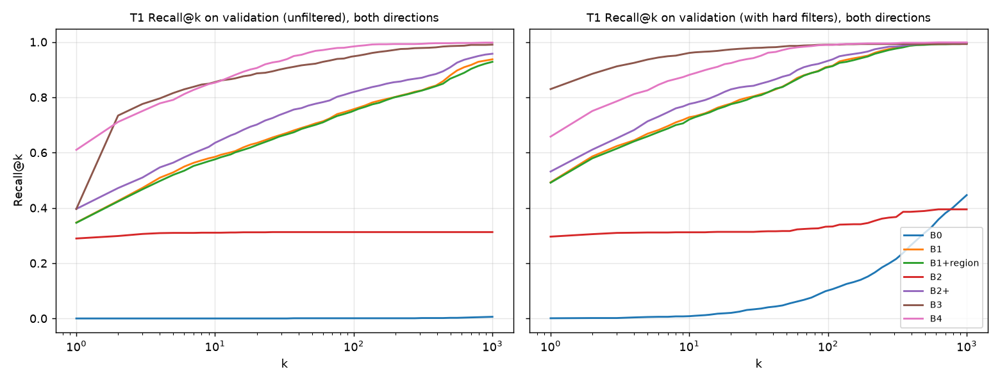
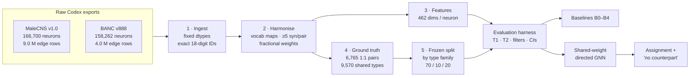
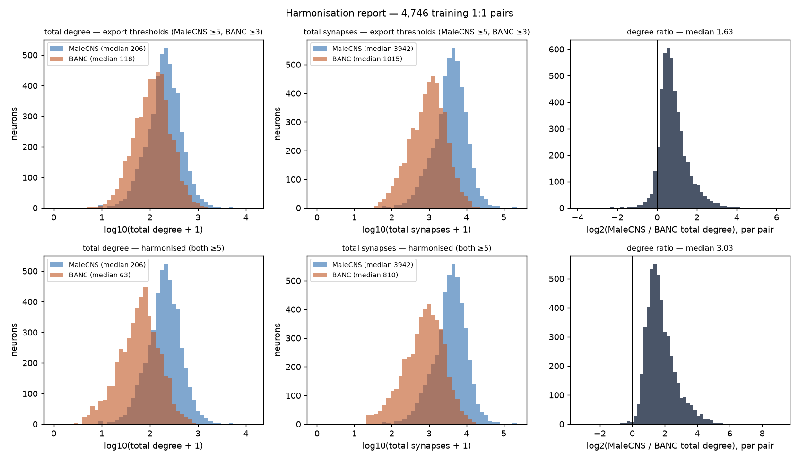
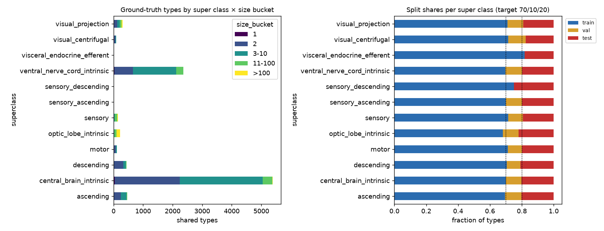

<div align="center">

# 🪰 Cross-Connectome Neuron Matching

### Finding the same neuron in a female and a male fruit-fly nervous system — with graph neural networks

**BANC** (female brain + nerve cord, 158,262 neurons) &nbsp;⟷&nbsp; **MaleCNS** (male brain + nerve cord, 166,700 neurons)

[](LICENSE)
[](DATA_LICENSE.md)
[](https://www.python.org/)
[](https://pytorch.org/)
[](tests/)
[](PROJECT_DIARY.md)
[](data/splits/splits_v1.json)

[**Results**](#-results-so-far) · [**Quick start**](#-quick-start) · [**How it works**](#-how-it-works) · [**Data**](#-the-data) · [**Train on Kaggle**](INSTRUCTIONS.md) · [**Diary**](PROJECT_DIARY.md) · [**Roadmap**](#%EF%B8%8F-roadmap)

</div>

---

## 🧠 The problem in one paragraph

Two complete wiring diagrams of a fruit-fly central nervous system now exist: one **female** (BANC, serial-section electron microscopy) and one **male** (MaleCNS, FIB-SEM). Each is a directed graph of ~160,000 neurons and millions of synaptic connections. Biologists want to know, for any neuron in one fly, **which neuron is "the same one" in the other**, or whether it has **no counterpart at all** (a sex-specific neuron). Today this relies on hand-curated cell-type names and morphology. This project learns it instead. A **shared-weight graph neural network** embeds neurons from both connectomes into one vector space. Matching then becomes nearest-neighbour search plus an assignment step, with a calibrated *"no counterpart"* answer.

<div align="center">

| What we build | What we will claim |
|---|---|
| A frozen, public **BANC ↔ MaleCNS matching benchmark** with baselines | The first benchmark of its kind for these two datasets |
| A **directed, sparse GNN** trained contrastively across sexes | Accuracy as a function of how many labelled pairs ("seeds") it gets |
| A calibrated **"no counterpart"** output | Abstention evaluated as a first-class task |
| **Controls** that separate biology from imaging artefacts | Evidence the model learned homology, not the microscope |

</div>

---

## 🏆 Results so far

All numbers are on the validation split.
- **T1, exact-partner retrieval:** Recall@1, averaged over both directions. Each of the 669 one-to-one pairs is ranked against **all ~116–160k included neurons** of the other dataset.
- **T2, cell-type accuracy:** whether the top match has the right type, macro-averaged over super classes.
- *Filtered* means the match must have the same super class, the same side and a compatible neurotransmitter.
- 95% confidence intervals are bootstrapped over type families.

The test split has **not** been touched.

| | Method | Uses labels? | T1 R@1 | T1 R@1 (filtered) | T1 MRR | T2 acc@1 |
|---|---|:-:|:-:|:-:|:-:|:-:|
| B0 | Random | – | 0.0% | 0.1% | 0.000 | 0.1% |
| B1 | √ neuropil in/out profiles (cosine) | – | 34.7% | 49.3% | 0.430 | 22.8% |
| B2 | NBLAST morphology (published matrix) | – | 28.9% | 29.6% | 0.298 | 35.8% |
| B2+ | B1 + NBLAST (z-scored sum) | – | 39.6% | 53.1% | 0.477 | 40.1% |
| B3 | cocoa-style label-projected connectivity | ✔ | 39.6% | **83.0%** | 0.597 | **57.4%** |
| B4 | MLP, contrastive (= GNN with 0 layers), 3 seeds | ✔ | **61.6 ± 0.7%** | 66.1% | **0.701** | 44.0% |
| **GNN** | **Directed message passing, 1–3 layers** | ✔ | *training on Kaggle (weeks 7–8)* | | | |

<p align="center"></p>

**Headlines**

- 🎯 **The bar for the GNN:** beat the MLP (61.6% R@1) and the cocoa-style baseline under filters (83.0%), each by more than the across-seed standard deviation.
- 🔗 **Connectivity carries real identity signal.** A zero-learning profile of *where* a neuron sends and receives synapses finds the exact partner among ~116,000 candidates 35% of the time. The shuffled control gets ≈ 0.1%.
- ⚖️ **Honest ranking matters.** 8% of queries tie with hundreds of neurons, because their profiles sit in a single neuropil. Counting ties as wins inflates B1 (MaleCNS → BANC) from 36.0% to 40.5%. Every rank here uses average-tie ranks.
- ↔️ **Label projection is side-blind.** B3 can't tell a partner's left copy from its right copy (40% at R@1, 73% at R@2). With a side filter it jumps to 83%.
- 🔬 **Published NBLAST is reliable only for some classes.** It works for ascending and descending neurons (≈ 60% top-1 type accuracy) but is weak for central-brain and VNC neurons. Its top-100 lists contain the true partner for only 31% of pairs.

Full analysis: [`docs/notes/phase1_weeks1-4.md`](docs/notes/phase1_weeks1-4.md) · [`docs/notes/phase2_weeks5-7.md`](docs/notes/phase2_weeks5-7.md)

---

## ⚡ Quick start

```powershell
git clone https://github.com/prabhu-omkar/Cross-Connectome-Neuron-Matching.git
cd Cross-Connectome-Neuron-Matching

py -3.11 -m venv .venv                       # (Linux/macOS: python3.11 -m venv .venv)
.venv\Scripts\python.exe -m pip install -r requirements.txt
.venv\Scripts\python.exe -m pip install torch --index-url https://download.pytorch.org/whl/cpu
.venv\Scripts\python.exe -m pip install -e .

.venv\Scripts\python.exe -m flymatch.run phase1      # raw CSVs → harmonised tables, features, ground truth, reports (~7 min)
.venv\Scripts\python.exe -m pytest -q                # 38 tests: units, data contracts, leakage
.venv\Scripts\python.exe -m flymatch.run baselines   # B0–B4 on validation → results/baselines.csv (~30 min, CPU)
```

The raw connectome exports ship **inside this repo** (`data/raw/`), so the pipeline runs straight after cloning. GPU training of the GNN runs on Kaggle; see **[INSTRUCTIONS.md](INSTRUCTIONS.md)**.

<details>
<summary><b>All commands</b></summary>

| Command | What it does |
|---|---|
| `python -m flymatch.run data` | ingest → harmonise → features → ground truth (~1.5 min) |
| `python -m flymatch.run split [--freeze]` | stratified family split; `--freeze` writes `splits_v1.json` **once** (refuses to overwrite) |
| `python -m flymatch.run report` | harmonisation report, neuropil-merge validation, GT composition (training pairs only) |
| `python -m flymatch.run phase1` | all of the above + B1 |
| `python -m flymatch.run baselines [--methods B0,B1,B2,B2+,B3,B4]` | baselines through the evaluation harness → `runs/`, `results/baselines.csv`, F4 |
| `python -m flymatch.run train --exp configs/experiments/gnn_L2.yaml --seeds 0,1,2 [--device cuda]` | train + evaluate; checkpoints every 200 steps, resumes automatically |
| `python -m flymatch.run package` | build `dist/flymatch_kaggle.zip` for Kaggle |
| `python -m flymatch.run aggregate` | all `runs/` → `results/baselines.csv` (rejects runs with a different split hash) |
| `python -m flymatch.smoke --layers 2` | full-graph GNN forward/backward memory + timing check |

</details>

---

## 🔬 How it works



### 1 · Harmonisation: removing the microscope before learning

The two datasets differ in ways that are pure artefact, and a model will happily learn them. So before anything else:

| Artefact | MaleCNS | BANC | What we do |
|---|---|---|---|
| Synapse threshold per neuron pair | ≥ 5 | ≥ 3 | Re-threshold **both** to ≥ 5 (removes 1.5 M weak BANC pairs) |
| Synapses detected | 89.9 M | 23.6 M (**3.8× fewer**) | **Fractional** edge weights; **rank-normalised** size features |
| Neuropil names | 134 (nerves, `*_UNASGD`) | 111 (`VNC_*` prefixes, split `IB`) | Hand-written map → **87 canonical neuropils**, every merge validated (Pearson r ≥ 0.5 on training pairs) |
| Super-class names | 27 (`ol_intrinsic`, 3 sensory classes…) | 16 (`optic_lobe_intrinsic`, one `sensory`) | Hand-written map → 12 harmonised classes |
| Root-ID format | small integers | **18-digit** IDs (break as float!) | Read as text → int64 with a round-trip check |

> 💡 **Discovery:** BANC stores **> 99%** of its leg-neuropil synapses under `VNC_T1_ProNm` / `VNC_T2_MesoNm` / `VNC_T3_MetaNm`, not `LegNp_*`. Mapping these, plus the old name `AMNp` → ovoid `Ov`, raised the zero-learning baseline on training pairs by 7 points overall and by 31 points for ascending neurons.

<p align="center"></p>

Equal thresholds actually *widen* the degree gap: the median MaleCNS/BANC degree ratio goes from 1.63 to 3.03. That is why fractional weights and within-dataset rank features are essential. A quantile-matched setting (MaleCNS ≥ 15, BANC ≥ 5, ratio 1.06) is kept as ablation A9.

### 2 · Node features (462 per neuron, identical column order in both datasets)

| Block | Dims | Definition |
|---|:-:|---|
| Neuropil input / output profile | 87 + 87 | √ of the fraction of the neuron's input (output) synapses in each canonical neuropil |
| Region summary | 6 + 6 | Fraction of synapses in optic lobe / central brain / GNG / VNC / nerve / unassigned |
| Size | 6 | In/out degree, in/out synapses, # neuropils — **quantiles within dataset** |
| Neurotransmitter | 9 + 1 | Harmonised predicted NT one-hot + confidence |
| Side · super class | 3 · 12 | One-hots |
| Hemilineage | 242 + 1 | Developmental lineage shared by both datasets (an annotation → ablated in A2) |
| *Label-projected connectivity* | *2 × seeds* | *Fraction of input/output to each seed type — built per seed fraction* |

### 3 · Ground truth, and why it is split by *family*

A MaleCNS neuron's harmonised type is its **Primary Cell Type** if BANC uses that name. Otherwise it is its **FlyWire type**, and failing that its **MANC type**. The fallbacks were validated: **99.6%** super-class agreement, which is better than primary names (99.5%). The result is **9,570 shared types** and **6,765 unambiguous one-to-one pairs** (same type, same side, exactly one neuron in each fly).

Splitting by neuron would leak (`LC10a` in train, `LC10b` in test). So types are grouped into **3,610 families** by union-find over shared name stems, co-listed alternative names and MaleCNS supertypes. The families are split **70 / 10 / 20**, stratified by super class × type size. The split is frozen and hashed: every run records `sha256 260be072…`, and the aggregator rejects anything else.

<p align="center"></p>

### 4 · The model

```text
x (462) ─► Linear-GELU-LN (256) ─► [ DirLayer ] × L ─► concat all layers ─► MLP ─► ℓ2-normalised z (128)

DirLayer:  h ← h + Dropout(GELU(LN( W_self·h  +  W_in·(A_in @ h)  +  W_out·(A_out @ h) )))
           A_in[j,i]  = fraction of j's input from i      (who talks to me)
           A_out[i,j] = fraction of i's output going to j  (whom I talk to)
```

- **One encoder with shared weights** embeds both connectomes into one space.
- **Sparse matrix products** (`torch.sparse.mm`) replace per-edge messages. A full 2-layer pass over both graphs (7.8 M edges) fits in **5.4 GiB**.
- **Multi-positive InfoNCE**, symmetric across datasets:
  - positives are neurons of the same type **and** side;
  - the same type on the other side is masked (neither positive nor negative);
  - negatives come only from **training** families.
- **Type-balanced sampling** keeps the 89,000 optic-lobe columnar neurons from drowning everything else.
- Coming in weeks 9–10: optional **class-conditional CORAL** or adversarial alignment, an abstention head, and Hungarian assignment.

---

## 📦 The data

| Dataset | Source | Licence | In this repo |
|---|---|---|---|
| **MaleCNS v1.0**: neurons + neuropil-split connections | [FlyWire Codex](https://codex.flywire.ai) export | CC BY 4.0 | `data/raw/mcns/` (47 MB) |
| **BANC v888**: neurons + neuropil-split connections | [FlyWire Codex](https://codex.flywire.ai) export | CC BY 4.0 | `data/raw/banc/` (32 MB) |
| BANC metadata (proofread flag, sexual dimorphism) | [Harvard Dataverse](https://doi.org/10.7910/DVN/7WTH1N) v3 | CC BY 4.0 | `data/external/` (58 MB) |
| BANC ↔ MaleCNS expert-reviewed matches · somas | Harvard Dataverse v3 | CC BY 4.0 | `data/external/` |
| BANC ↔ MaleCNS v0.9 NBLAST matrix (912 MB) | Harvard Dataverse v3 | CC BY 4.0 | [GitHub Release](https://github.com/prabhu-omkar/Cross-Connectome-Neuron-Matching/releases) |
| Processed tables + features (Kaggle package, 84 MB) | generated by this code | CC BY 4.0 | [GitHub Release](https://github.com/prabhu-omkar/Cross-Connectome-Neuron-Matching/releases) |
| Frozen benchmark split | this project | CC BY 4.0 | `data/splits/splits_v1.json` |

Exact file IDs, sizes and download dates: [`data/external/SOURCES.md`](data/external/SOURCES.md). Attribution and citations: [`DATA_LICENSE.md`](DATA_LICENSE.md).

<details>
<summary><b>Side-by-side profile of the two connectomes</b></summary>

| Property | MaleCNS v1.0 (male) | BANC v888 (female) |
|---|---|---|
| Imaging | FIB-SEM, 8 × 8 × 8 nm | serial-section TEM, 4 × 4 × 45 nm |
| Neurons in export | 166,700 | 158,262 |
| Connection rows (neuropil-split) | 9,039,608 | 3,990,039 |
| Distinct neuron pairs | 6,242,085 (excluding 56 self-loop rows) | 3,037,361 → 1,528,585 after ≥ 5 |
| Primary cell type filled | 98.7% | 74.9% |
| Super class filled | 100% | 92.7% |
| Included after quality rules | 159,632 | 116,553 |
| Clean subset | 54,062 (`Reviewed`) | 122,177 (proofread, no tracing flags) |

</details>

---

## 🗂️ Repository layout

```text
Cross-Connectome-Neuron-Matching/
├── README.md · INSTRUCTIONS.md (Kaggle) · PROJECT_DIARY.md · LICENSE · NOTICE · DATA_LICENSE.md
├── configs/
│   ├── data.yaml                    thresholds, inclusion rules, GT sources, split seed
│   ├── paths.example.yaml           where the raw data lives (defaults: data/raw, data/external)
│   ├── model/ · train/              GNN / MLP and training defaults
│   └── experiments/                 mlp, gnn_L1, gnn_L2, gnn_L3, baselines, smoke test
├── maps/                            hand-maintained vocabulary maps (ingest fails on any unmapped value)
│   ├── neuropil_map.csv             245 rows: raw → canonical neuropil, region, include, confidence, note
│   └── superclass_map.csv · nt_map.csv · hemilineage_map.csv
├── data/
│   ├── raw/{mcns,banc}/             the two Codex exports (read-only)
│   ├── external/                    BANC Dataverse files + SOURCES.md
│   ├── splits/splits_v1.json        FROZEN benchmark split + .sha256
│   └── interim/ · processed/        regenerated by `run data` (git-ignored)
├── src/flymatch/
│   ├── io.py · ingest.py            fixed-dtype readers, raw → canonical parquet
│   ├── harmonise.py                 thresholds, fractional weights, inclusion rules
│   ├── features.py                  462-dim node features + L↔R mirror permutation
│   ├── groundtruth.py               harmonised types, fallback validation, 1:1 pairs, families
│   ├── splits.py · seeds.py         frozen family split; nested seed sets for the ablation
│   ├── evaluate.py                  THE harness: T1/T2, filters, clean subset, breakdowns, bootstrap CIs
│   ├── graph.py                     sparse A_in / A_out, undirected variant, degree-preserving permutation
│   ├── models/                      DirLayer, Encoder, InfoNCE / CORAL / gradient reversal
│   ├── train.py · experiment.py     contrastive training with checkpoint/resume; config-driven runs
│   ├── baselines/                   B0 random · B1 profiles · B2 NBLAST · B3 cocoa-style · B4 MLP
│   ├── report.py · runs.py          Phase-1 reports; run folders + aggregation
│   ├── package.py · smoke.py        Kaggle package; full-graph memory check
│   └── run.py                       one CLI for everything
├── kaggle/kaggle_train.py           paste-into-one-cell Kaggle notebook
├── results/                         every reported table and figure (written by scripts only)
├── docs/plan.md · docs/notes/       16-week plan; per-phase findings
└── tests/                           38 tests: units, synthetic harness, data contracts, leakage
```

---

## 🧪 Rigour built in

- 🔒 **Frozen, hashed split.** Test families are touched **once**, at the end of week 12.
- 🧱 **Leakage tests:**
  - families are disjoint across splits;
  - sibling types sharing a name stem never sit in different splits;
  - negatives come only from training families;
  - seed types come only from training.
- 📏 **One evaluation harness** for every method, checked on synthetic data (identical embeddings → 100%, random → chance).
- 🎲 **Statistics:** 3 seeds per stochastic method; 95% CIs by bootstrapping **families**, not neurons; paired bootstrap for method comparisons.
- 🧹 **Clean-subset reporting** (MaleCNS `Reviewed` + BANC proofread) for every headline number.
- 🧾 **Every number comes from a script**, never a notebook. Every run folder stores the config, the git SHA and the split hash.
- 🧭 **Planned controls:** degree-preserving edge shuffling (C4), label permutation (C5), within-dataset left↔right (C3), hemibrain transfer (C1).

---

## 🗺️ Roadmap

| Week | Work | Status |
|:-:|---|:-:|
| 1 | Repo, environment, fixed-dtype ingest, vocabulary maps, inclusion rules | ✅ |
| 2 | Threshold harmonisation, fractional weights, harmonisation report | ✅ |
| 3 | Node features, ground truth, fallback validation, clean subset | ✅ |
| 4 | Type families, stratified split — **frozen** (Gate G1) | ✅ |
| 5 | Evaluation harness, B0 / B1 / B2, Recall@k, filters | ✅ |
| 6 | B3 cocoa-style, B4 MLP, sparse graph + encoder (Gate G2) | ✅ |
| 7 | GPU training, checkpoint/resume, Kaggle package · first GNN runs | 🟡 code ✅ · runs pending |
| 8 | Multi-positive InfoNCE at scale; GNN vs MLP | ⬜ |
| 9 | Hard negatives (k = 50 shortlist), CORAL — Gate G3 | ⬜ |
| 10 | Abstention head, assignment, freeze model — Gate G4 | ⬜ |
| 11–12 | **Seed-ablation curve**, ablations A1–A10, controls C2–C5, **test once** | ⬜ |
| 13 | Hemibrain transfer (C1), error analysis | ⬜ |
| 14–15 | Web tool (FastAPI + Streamlit): paste a neuron ID, get its counterpart | ⬜ |
| 16 | Thesis, release, benchmark card, demo | ⬜ |

Day-by-day log: **[PROJECT_DIARY.md](PROJECT_DIARY.md)**.

---

## ⚠️ Known limitations (stated up front)

- **Circularity.** BANC types were partly assigned with NBLAST and connectivity matching to FlyWire, and MaleCNS types were harmonised against FlyWire. So the ground truth reaches across sexes through FlyWire names, and it was built with signals related to ours. Mitigations: the clean subset, manual inspection of errors, and comparing methods relative to each other.
- **Naming ≠ biology.** Only 53% of the BANC team's expert-reviewed BANC ↔ MaleCNS matches share our harmonised type. The disagreements are naming schemes (`R7` vs `R7y`, `EFFabg*` vs `MNad*`), concentrated in sensory and motor neurons. Those classes are therefore under-represented in the one-to-one ground truth.
- **Optic-lobe columns** (hundreds of near-identical copies) are evaluated at type level (T2), not neuron level.
- **VNC neuropils** were merged coarsely, and `mVAC_T2` was excluded after failing merge validation.

---

## 📚 Citing the data

> Bates, A. S., Phelps, J. S., Kim, M., … Lee, W.-C. A. (2026). *Distributed control circuits across a brain-and-cord connectome.* **Nature** 656, 957–970. Data: Harvard Dataverse, doi:10.7910/DVN/7WTH1N.

> *Sexual dimorphism in the complete Drosophila male CNS connectome.* **Cell** (2026). MaleCNS v1.0, male-cns.janelia.org.

> Matsliah, A., et al. (2026). *Uncovering sex differences in the Drosophila ventral nerve cord through connectome alignment.* bioRxiv, doi:10.64898/2026.06.14.732053.

More in [`DATA_LICENSE.md`](DATA_LICENSE.md) and [`docs/plan.md`](docs/plan.md#14-references-and-data-sources).

---

## 📄 Licence

Code: **Apache License 2.0**; see [LICENSE](LICENSE) and [NOTICE](NOTICE).
Data in `data/raw` and `data/external`, and data derived from it: **CC BY 4.0**, belonging to the original authors; see [DATA_LICENSE.md](DATA_LICENSE.md).

<div align="center"><sub>Final-year B.E. project · built by <a href="https://github.com/prabhu-omkar">@prabhu-omkar</a></sub></div>
